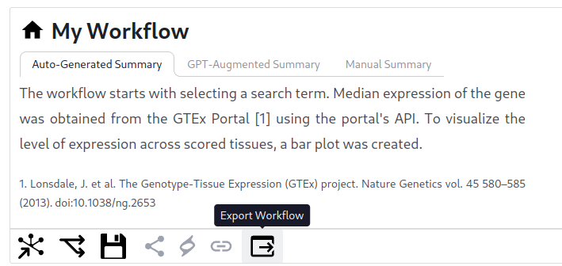

# API User Guide

The Playbook Partnership API allows you to construct workflows via a REST API. Workflows are specified using a JSON serialized domain specific language (DSL), they are then registered into the database and either the output can be resolved or the resulting playbook can be visited.

The machine-readable OpenAPI 3.1 description is available at `/api/openapi.json`. It documents the public workflow export, BCO, CWL, RO-Crate, file upload (`/api/v1/uploads`), and GA4GH DRS JSON endpoints. Binary downloads and the single request file upload are documented below because they use native HTTP handlers.

## Building a Workflow

A workflow can first be constructed via the playbook workflow builder user interface, see the [Building Workflows with the Playbook](./workflows.md) guide for more details. Once constructed, from the report mode the workflow can be "exported" as a JSON document.


**Figure 1.** The button on the user interface for exporting a playbook workflow as JSON.

This document looks something like so:
```json
{
  "data":{
    "12c02bd3-f2ec-c719-533f-b1bb3b0170b7":{"type":"Input[Gene]","value":"ACE2"}
  },
  "workflow":[
    {"id":"83efe773-027b-4f21-688d-b27555938a04","type":"Input[Gene]","data":{"id":"12c02bd3-f2ec-c719-533f-b1bb3b0170b7"}},
    {"id":"43854076-44ba-9ccb-22ce-d0f111c32752","type":"GTExTissueExpressionFromGene","inputs":{"gene":{"id":"83efe773-027b-4f21-688d-b27555938a04"}}},
    {"id":"33cdac4f-49de-6c59-5566-917e1bd390a3","type":"BarplotFrom[Scored[Tissue]]","inputs":{"terms":{"id":"43854076-44ba-9ccb-22ce-d0f111c32752"}}}
  ],
  "metadata":{
    "title":"GTEx Tissue Expression Barplot"
  }
}
```

## Parameterizing the Workflow in API calls
This same format is used to submit to the API, but naturally we'll want to change the inputs:

```python
import requests

# The playbook workflow builder endpoint to query
ENDPOINT = 'https://playbook-workflow-builder.cloud'

# Construct a workflow Gene => GTEx Tissue => Barplot with the input: ACE2
gene = 'ACE2'
res = requests.post(ENDPOINT + '/api/db/fpl', json={
  "data":{
    "12c02bd3-f2ec-c719-533f-b1bb3b0170b7":{"type":"Input[Gene]","value":gene}
  },
  "workflow":[
    {"id":"83efe773-027b-4f21-688d-b27555938a04","type":"Input[Gene]","data":{"id":"12c02bd3-f2ec-c719-533f-b1bb3b0170b7"}},
    {"id":"43854076-44ba-9ccb-22ce-d0f111c32752","type":"GTExTissueExpressionFromGene","inputs":{"gene":{"id":"83efe773-027b-4f21-688d-b27555938a04"}}},
    {"id":"33cdac4f-49de-6c59-5566-917e1bd390a3","type":"BarplotFrom[Scored[Tissue]]","inputs":{"terms":{"id":"43854076-44ba-9ccb-22ce-d0f111c32752"}}}
  ],
  "metadata":{
    "title":"GTEx Tissue Expression Barplot"
  }
})
playbook_id = res.json()
print(ENDPOINT + '/report/' + playbook_id)

# Obtain machine readable output of all nodes
output = requests.get(ENDPOINT + f"/api/db/fpl/{playbook_id}/output/export").json()
print(output)
```

## Explaining `/output`
Output follows the same form as the input, but each node will additionally have an `output` field with raw JSON corresponding to the typed information. For example:
```json
{
  "data":{
    "12c02bd3-f2ec-c719-533f-b1bb3b0170b7":{"type":"Input[Gene]","value":"ACE2"},
    "17165506-14be-2602-ba46-bc5f96d1ae6d":{"type":"Term[Gene]","value":"ACE2"},
    "6f2d30c6-f660-af7c-6f73-8d29bf2caa2b":{"type":"Scored[Tissue]","value": {}},
    "d4a4b8ab-049b-3ea6-96d3-d1f240fd1a11":{"type":"PlotlyPlot","value": {}}
  },
  "workflow":[
    {"id": "83efe773-027b-4f21-688d-b27555938a04", "type": "Input[Gene]", "data": {"id": "12c02bd3-f2ec-c719-533f-b1bb3b0170b7"}, "output": {"id": "17165506-14be-2602-ba46-bc5f96d1ae6d"}},
    {"id": "43854076-44ba-9ccb-22ce-d0f111c32752", "type": "GTExTissueExpressionFromGene", "inputs": {"gene": {"id": "83efe773-027b-4f21-688d-b27555938a04"}}, "output": {"id": "6f2d30c6-f660-af7c-6f73-8d29bf2caa2b"}},
    {"id": "33cdac4f-49de-6c59-5566-917e1bd390a3", "type": "BarplotFrom[Scored[Tissue]]", "inputs": {"terms": {"id": "43854076-44ba-9ccb-22ce-d0f111c32752"}}, "output": {"id": "d4a4b8ab-049b-3ea6-96d3-d1f240fd1a11"}}
  ],
  "metadata":{
    "title":"GTEx Tissue Expression Barplot"
  }
}
```

Note that the structure of each data `value` depends on the `type`. The public endpoint shapes and parameters are described by `/api/openapi.json`; component-specific value schemas remain part of the component catalog.


## Workflows with Files
In the case of a file, the "FileURL" takes an arbitrary http url or [DRS URI](https://ga4gh.github.io/data-repository-service-schemas/preview/release/drs-1.2.0/docs/).

```python
import requests

# The playbook workflow builder endpoint to query
ENDPOINT = 'https://playbook-workflow-builder.cloud'

# Construct a workflow FileInput => AnnDataFromFile => Limma-Voom with the example.h5ad file
res = requests.post(ENDPOINT + '/api/db/fpl', json={
  "workflow": [
    {"id": "0", "type": "FileInput", "data": { "type": "FileURL", "value": { "url": "https://example.org/example.h5ad", "filename": "example.h5ad" } } },
    {"id": "1", "type": "AnnDataFromFile", "inputs": { "file": { "id": "0" } } },
    {"id": "2", "type": "Limma-Voom", "inputs": { "anndata": { "id": "1" } } }
  ]
})
print(ENDPOINT + '/graph/' + res.json())
```

Note, from this example that workflows can be constructed somewhat manually if familiar with the available components. `data` can be inlined, and `id`s can be arbitrary strings.

## Uploading Files

Files you upload can be used in workflows just like files at a URL. Uploading requires an API key, which acts as you: uploaded files belong to your account (and are listed under [Account › Uploads](https://playbook-workflow-builder.cloud/account/uploads)).

### API Keys

Create an API key under [Account › API Keys](https://playbook-workflow-builder.cloud/account/api-keys): give it a name and choose when it expires. The key (starting with `pwb_`) is only shown once, copy it somewhere safe; you can revoke it from the same page at any time. Send it with each request in the `x-api-key` header (or as `Authorization: Bearer <key>`):

```bash
export PWB_API_KEY=pwb_...
```

### Small Files

Small files (up to about 100MB) can be uploaded in a single `multipart/form-data` request, with the file in the `file` field:

```bash
curl -X POST https://playbook-workflow-builder.cloud/api/file/upload \
  -H "x-api-key: $PWB_API_KEY" \
  -F file=@my_signature.tsv
```

```json
{"file":[{"id":"…","url":"drs://playbook-workflow-builder.cloud/3da99917a6f0a5d96f648ae6ecb04af7f3f8480c62bce9a9aee42395fadd6eab","filename":"my_signature.tsv","sha256":"3da99917a6f0a5d96f648ae6ecb04af7f3f8480c62bce9a9aee42395fadd6eab","size":80}]}
```

A single request must complete within the server's request timeout (about a minute), so larger files should be uploaded in parts.

### Large Files

Large files are uploaded directly to storage, in parts:

1. `POST /api/v1/uploads` with the file's `filename` & `size` (in bytes) starts the upload. It returns a `token` for the upload, and how to split the file: `partCount` parts of `partSize` bytes (the last part may be smaller).
2. `POST /api/v1/uploads/parts` with the `token` & up to 100 `partNumbers` (starting from 1) gives a `url` for each part (& `headers` to send with it). `PUT` each part's exact bytes to its url, and keep the `ETag` response header. Don't send your API key to these urls (they're authorized by themselves, and typically go straight to storage); they expire after an hour, so get them as you go.
3. `POST /api/v1/uploads/complete` with the `token`, the `parts` (`partNumber` & `etag` of each) and the file's `sha256` (hex) assembles the file. It returns the upload's `id`.
4. The server then verifies the file in the background: `GET /api/v1/uploads/{id}` gives `{"status": "verifying"}` until it has, then `{"status": "verified", "url": "drs://…/<sha256>", "filename": …, "sha256": …, "size": …}`. The `url` refers to the file in workflows.

If an upload fails part way, `POST /api/v1/uploads/abort` with the `token` discards it.

```python
import os
import time
import hashlib
import requests

ENDPOINT = 'https://playbook-workflow-builder.cloud'
api = requests.Session()
api.headers['x-api-key'] = os.environ['PWB_API_KEY']

def upload_file(path):
  ''' Upload the file at `path`, returning its record (with the `url` to use in workflows) '''
  upload = api.post(f"{ENDPOINT}/api/v1/uploads", json={
    'filename': os.path.basename(path),
    'size': os.path.getsize(path),
  })
  upload.raise_for_status()
  token, part_size, part_count = upload.json()['token'], upload.json()['partSize'], upload.json()['partCount']
  sha256 = hashlib.sha256()
  parts = []
  try:
    with open(path, 'rb') as fr:
      for first in range(1, part_count + 1, 100):
        part_numbers = list(range(first, min(first + 100, part_count + 1)))
        targets = api.post(f"{ENDPOINT}/api/v1/uploads/parts", json={'token': token, 'partNumbers': part_numbers})
        targets.raise_for_status()
        for target in targets.json():
          body = fr.read(part_size)
          sha256.update(body)
          # (not with `api`: these urls mustn't be sent your API key)
          res = requests.put(target['url'], data=body, headers=target['headers'])
          res.raise_for_status()
          parts.append({'partNumber': target['partNumber'], 'etag': res.headers.get('ETag')})
    complete = api.post(f"{ENDPOINT}/api/v1/uploads/complete", json={'token': token, 'parts': parts, 'sha256': sha256.hexdigest()})
    complete.raise_for_status()
  except BaseException:
    api.post(f"{ENDPOINT}/api/v1/uploads/abort", json={'token': token})
    raise
  # wait for the file to be verified
  while True:
    status = api.get(f"{ENDPOINT}/api/v1/uploads/{complete.json()['id']}")
    status.raise_for_status()
    if status.json()['status'] == 'verified':
      return status.json()
    time.sleep(2)

file = upload_file('my_counts.h5ad')
print(file['url'])
```

Parts can also be uploaded concurrently (e.g. with a thread pool), in any order.

### Using an Uploaded File

Use the file's record in a `FileInput`, like a file at a URL:

```python
res = requests.post(ENDPOINT + '/api/db/fpl', json={
  "workflow": [
    {"id": "0", "type": "FileInput", "data": { "type": "FileURL", "value": { "url": file['url'], "filename": file['filename'], "size": file['size'] } } },
    {"id": "1", "type": "AnnDataFromFile", "inputs": { "file": { "id": "0" } } },
  ]
})
print(ENDPOINT + '/graph/' + res.json())
```

Uploaded files are referred to by their content (their sha256), so uploading the same file again gives the same `url`, and workflows using it (with the same filename & description) reuse the results already computed for it rather than computing them again.

## Using the ID

Both of these examples will return an `id` for the workflow. This id can be used as follows:
- `https://playbook-workflow-builder.cloud/graph/{id}` => The graph mode UI of the workflow
- `https://playbook-workflow-builder.cloud/report/{id}` => The report mode UI of the workflow
- `https://playbook-workflow-builder.cloud/api/db/fpl/{id}` => See the resulting workflow as registered in the db
- `https://playbook-workflow-builder.cloud/api/db/fpl/{id}/export` => Slightly reformatted version of above
- `https://playbook-workflow-builder.cloud/api/db/fpl/{id}/output` => See the resulting workflow along with its output (for all nodes)
- `https://playbook-workflow-builder.cloud/api/db/fpl/{id}/output/export` => Slightly reformatted version of above

Each process (step of the workflow) can be accessed independently, those ids are at `[{"id": "fpl_id", "process": { "id": "{process_id}", ... }, ... }]` and can be accessed like:
- `https://playbook-workflow-builder.cloud/api/db/process/{id}` => See the resulting process as registered in the db
- `https://playbook-workflow-builder.cloud/api/db/process/{id}/output` => See the resulting process along with its output (for all nodes)

## Learn More

[Find other topics in the Playbook Workflow Builder user guide](./index.md).
